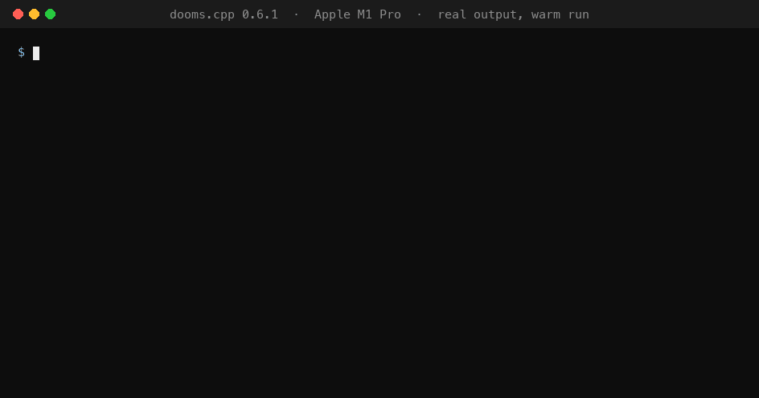

# dooms.cpp

An inference engine for Apple Silicon that runs language, speech (Whisper, Kokoro text to speech), vision-language and vision-language-action models from C++,
C and Python, on the GPU (Metal) and the Neural Engine (Core ML).



- **LLMs**: its own Metal decoder for llama and Qwen2 models in f16 and 4-bit GGUF (Q4_0, Q4_K_M and their q5_0/q8_0/q6_K parts; fused kernels, flash-attention prompt processing, the next token picked on the GPU), and
  any other GGUF through [llama.cpp](https://github.com/ggml-org/llama.cpp) (every architecture and quantization). Chat templates, streaming, stop strings,
  seeded sampling, and an OpenAI-compatible server (`dooms serve`).
- **Vision-language** (SmolVLM): the vision tower on the Neural Engine, the language model on the engine's own decoder.
- **Text to speech** (Kokoro-82M): prosody on Core ML, the vocoder on the engine's own Metal kernels; English text through misaki.
- **Speech to text** (Whisper, tiny to large-v3-turbo): the encoder on Core ML, the decoder on the engine's own Metal kernels; any audio file Core Audio decodes.
- **Vision-language-action** (SmolVLA): three cameras plus a prompt to a 50-step action chunk in about 270 ms, and an asynchronous runner that computes the next
  chunk while the robot executes the current one.
- **Packaging**: a self-contained Python wheel, a C/C++ SDK with `find_package(dooms)`, a command-line tool, `dooms pull` for verified model downloads.

Apple Silicon macOS only. The engine is an inference engine, not a trainer.

## 256 tokens/s at 4-bit, against MLX-LM's 224

| Qwen2.5-0.5B-Instruct, 512-token prompt, 128 tokens, M1 Pro | writing the answer (decode), tokens/s | reading the prompt, tokens/s |
|---|--:|--:|
| **dooms.cpp, own Metal decoder, Q4_0** (271 MB) | **256.1** | 3975 |
| llama.cpp, same file | 238.7 | **4256** |
| MLX-LM 4-bit, mlx-community (265 MB) | 224.3 | 3814 |

The engine picks llama.cpp's greedy tokens on every prompt tested, from the same file. Rerun it on your Mac (builds, downloads pinned models, prints this
table and the token check; about 2 GB):

```
git clone https://github.com/jay7828/dooms && cd dooms
scripts/reproduce-4bit.sh
```

Please share your numbers (chip, memory, macOS) in an issue: every figure here comes from one M1 Pro. Q4_0 is the GGUF of MLX-LM's 4-bit size, not of its
accuracy: MLX's affine 4-bit blocks keep more per bit. Reading the prompt, the engine is ahead of MLX-LM at every length measured (17, 82 and 512 tokens)
and behind llama.cpp (7% at 512 tokens); llama.cpp's Q4_K_M mix runs at 209.2 tokens/s on the engine (llama.cpp: 165.3), below MLX-LM's 4-bit model.

## Benchmarks

Apple M1 Pro (16 GB), macOS 26.6, plugged in, interleaved rounds so every runtime meets the same conditions, each baseline in its fastest configuration, the
same precision everywhere (f16 unless stated). Full tables, methods and history: [dooms-kappa.vercel.app](https://dooms-kappa.vercel.app) and
`bench/BASELINES.md`.

**Text LLM** (Qwen2.5-0.5B-Instruct, 512-token prompt, then 128 greedy tokens)

| | decode, tokens/s | prompt, tokens/s |
|---|--:|--:|
| **dooms.cpp f16** | **137.9** | 4263 |
| MLX-LM fp16 | 136.2 | 3864 |
| llama.cpp f16 | 130.7 | **4604** |
| PyTorch MPS fp16 | 37.6 | 2492 |

Fastest f16 decode; the prompt is 6% behind llama.cpp (4263 vs 4525 tokens/s measured together, 2026-10-23). 4-bit files run on the engine's own decoder too:

| 4-bit, 512-token prompt, 128 tokens | decode tokens/s | prompt tokens/s |
|---|--:|--:|
| **dooms.cpp Q4_0** (271 MB) | **256.1** | 3975 |
| llama.cpp Q4_0 (same file) | 238.7 | **4256** |
| MLX-LM 4-bit (mlx-community, 265 MB) | 224.3 | 3814 |
| **dooms.cpp Q4_K_M** (379 MB) | 209.2 | 3689 |
| llama.cpp Q4_K_M (same file) | 165.3 | 3634 |

Q4_0 (`llama-quantize --pure`) is MLX-LM's 4-bit size; MLX's affine 4-bit keeps more accuracy per bit than Q4_0's symmetric blocks.

**Vision-language** (SmolVLM-256M, one 512x512 image and a question)

| | decode, ms/token | first token, ms | vision tower, ms |
|---|--:|--:|--:|
| **dooms.cpp** | **2.70** | **82.5** | **62.2** |
| MLX fp16 | 3.44 | 97.0 | 68.6 |
| llama.cpp (text model alone) | 4.11 | | 86 per tile |
| PyTorch MPS | 27.3 | 139.4 | 106.2 |

**Vision-language-action** (SmolVLA, three cameras + prompt + state to 50 actions): dooms.cpp 266.6 ms, MLX 469.3 ms (1.76x), PyTorch MPS 603.8 ms (2.26x).
In a simulated 30 Hz control loop the asynchronous runner removes every stall (90 waited steps to 0).

**Speech to text** (Whisper, 73 LibriSpeech clips = 481 s of audio, greedy, f16; time for all of them)

| | large-v3-turbo | WER | tiny | WER |
|---|--:|--:|--:|--:|
| **dooms.cpp** | **53.6 s** | 3.25% | **2.81 s** | 12.2% |
| MLX-Whisper fp16 | 53.6 s | 3.42% | 3.03 s | 12.1% |
| whisper.cpp (Metal) | 63.8 s | 3.25% | 5.05 s | 12.0% |
| PyTorch MPS fp16 | 105.0 s | 3.25% | 15.1 s | 12.1% |
| Sapient (Metal) | 948 s | 3.34% | 68.6 s | 18.5% |

Level with MLX on turbo (the encoder, the same time in both, is 90% of it), 7% ahead on tiny (21% on one 8-minute file), with PyTorch's WER.

**Text to speech** (Kokoro-82M, 73 sentences = 404 s of speech, the same phonemes and voice for every engine)

| | seconds | Whisper WER of the audio |
|---|--:|--:|
| **dooms.cpp** | **15.1** | 3.34% |
| MLX fp32 (mlx-audio) | 23.5 | 3.42% |
| PyTorch MPS fp32 | 33.3 | 3.34% |
| ONNX Runtime CPU | 86.0 | 3.42% |

Tokens match transformers' on the reference prompts, photos and audio clips for every model above; Kokoro's audio matches PyTorch's within 1.4e-2 given the same noise.

## Use it

```
pip install dooms-cpp                         # PyPI; the import and the command are both `dooms`
dooms pull qwen2.5-0.5b                       # downloads and verifies a GGUF (SHA-256)
dooms serve --model ~/.cache/dooms/qwen2.5-0.5b-instruct-q4_k_m.gguf   # OpenAI-compatible API on 127.0.0.1:8080
dooms pull whisper-large-v3-turbo             # speech to text, ready converted (1.5 GB; whisper-tiny: 69 MB)
dooms pull kokoro                             # text to speech, ready converted, 54 voices (237 MB)
```

```python
import dooms
llm = dooms.LLM("qwen2.5-0.5b-instruct-f16.gguf")      # f16 llama/qwen2: the engine's own Metal decoder
print(llm.chat([{"role": "user", "content": "Name three colours."}], max_new_tokens=48))

stt = dooms.Whisper("~/.cache/dooms/whisper-large-v3-turbo")
print(stt.transcribe("meeting.m4a"))
tts = dooms.TTS("~/.cache/dooms/kokoro")                 # pip install "misaki[en]" for English text
dooms.save_wav("hello.wav", tts.speak("Hello from dooms.cpp."), tts.sample_rate)
```

```cpp
#include <dooms/dooms.hpp>
dooms::Llm llm("qwen2.5-0.5b-instruct-f16.gguf");
std::cout << llm.chat({{"user", "Name three colours."}}, 48) << "\n";
```

See [docs/USING.md](docs/USING.md) for installation and the full API (LLM, VLM, VLA and the asynchronous runner, Whisper, TTS, the server, `dooms pull`).
Models are not bundled in the package: `dooms pull` fetches them (Whisper and Kokoro as ready converted files, with their licences).
Every model runs on the GPU by default; `device="cpu"` (or `DOOMS_DEVICE=cpu`, `--device cpu`) runs the LLM, Whisper and Kokoro on the CPU instead, and `"auto"`
falls back to the CPU by itself when no Metal device can run them.

## Build
```
python3 -m venv .venv && .venv/bin/pip install cmake ninja numpy
export PATH="$PWD/.venv/bin:$PATH"
cmake -B build -G Ninja -DCMAKE_BUILD_TYPE=Release
cmake --build build -j
ctest --test-dir build --output-on-failure
scripts/package-python.sh     # dist/dooms_cpp-*.whl (release steps: docs/RELEASING.md)
scripts/package-sdk.sh        # dist/dooms-sdk-*.tar.gz
```
The first configure fetches llama.cpp (pinned in `CMakeLists.txt`).

## Scope
The engine's own Metal kernels run llama/Qwen2 text models in f16 and the convolutional graphs; Core ML runners serve the vision towers and SmolVLA on the
Neural Engine; llama.cpp runs every other GGUF (other architectures, quantized files). The prompt kernels borrow the structure of llama.cpp's Metal matmul
(MIT). Not included: training, non-Apple platforms, and the hand-mesh models (see `NOTICE`).

## Licence
Apache-2.0 (`LICENSE`). Third-party software and model licences: `NOTICE`.
